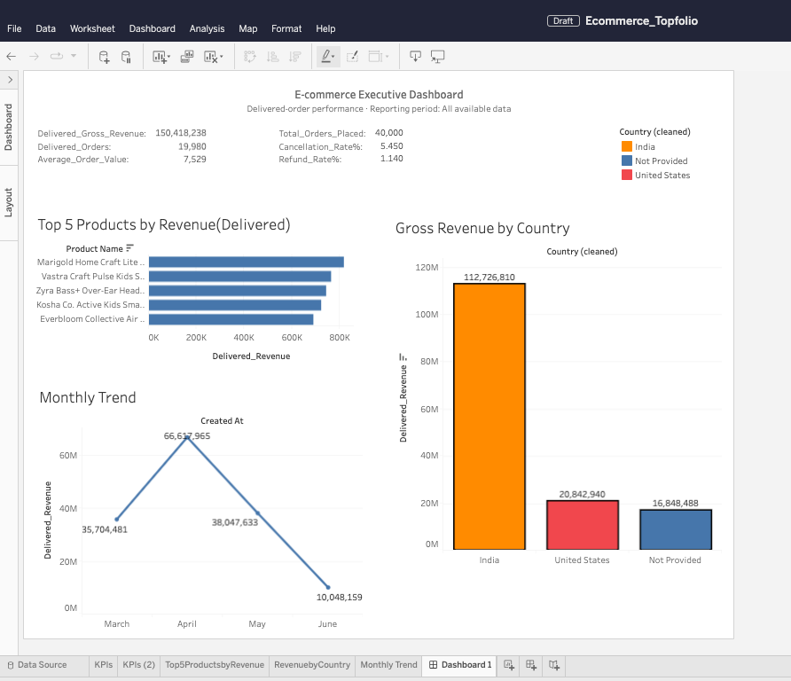

# E-commerce Executive Dashboard | SQL & Tableau

**Author:** Neharika Mandhan  
**Project Type:** Data Analytics | Business Intelligence  
**Tools:** PostgreSQL · SQL · Tableau · Git · GitHub

## Overview

This project analyzes e-commerce order data to help business stakeholders understand revenue performance, order fulfilment, product performance, geographic sales distribution, and refunds.

I used PostgreSQL to calculate and validate the key performance indicators (KPIs), then built an interactive Tableau dashboard to bring the findings together in a single executive view. The dashboard was revised following stakeholder feedback to improve metric clarity and make the analysis more useful for decision-making.

## Executive Dashboard



The dashboard brings together revenue, order volume, average order value, cancellation rate, refund rate, product performance, country-level revenue, and monthly revenue trends.

**Key metrics from the current analysis:**

| Metric | Result |
|---|---:|
| Delivered revenue                 | 150.42 million* |
| Delivered orders                  | 19,980 |
| Average order value               | 7,528.82* |
| Total orders placed               | 40,000 |
| Cancellation rate                 | 5.45% |
| Refund rate on delivered orders   | 1.14% |

*Revenue and average order value are shown in the dataset's monetary units; the currency has not been independently verified.*

## Business Questions

- How much revenue was generated by delivered orders?
- What is the average value of a delivered order?
- Which products contribute the most revenue?
- Which countries generate the most revenue?
- How does revenue change month over month?
- What proportion of orders are cancelled?
- What proportion of delivered orders have successful refunds?

## Analytical Approach

1. **Data analysis in PostgreSQL:** Wrote SQL queries to calculate revenue, order volume, average order value, monthly revenue growth, top products, country-level revenue, cancellations, and refunds.
2. **Metric validation:** Used distinct order counts for order-based metrics and refined the refund calculation to measure successful refunds against delivered orders.
3. **Dashboard development:** Built a Tableau executive dashboard with KPI summaries and supporting charts.
4. **Stakeholder iteration:** Revised the dashboard in response to feedback about order-count clarity, refund-rate accuracy, monthly growth, and filtering.

## Repository Structure

Dashboarding/
├── dashboards/
│   ├── screenshots/
│   │   └── v2.png
│   ├── 01_revenue_and_products.sql
│   ├── 02_orders_and_operations.sql
│   ├── design.md
│   ├── draft_notes.md
│   ├── ecommerce_dashboard_v2.twbx
│   ├── kpi_plan.md
│   ├── layout_sketch.md
│   ├── requirements.md
│   ├── response_to_feedback.md
│   └── tableau_public_link.txt
├── findings/
│   └── 00_executive_summary.md
├── README.md
└── settings.json
```

## Key Learnings

- Translating business questions into measurable KPIs.
- Writing SQL aggregations and window functions for monthly trend analysis.
- Distinguishing placed orders from delivered orders.
- Validating refund metrics against a clearly defined order population.
- Iterating on a dashboard using stakeholder feedback.
- Documenting analytical assumptions and visual design choices.

## What I Would Analyze Next

- Compare revenue and fulfilment performance across order statuses.
- Investigate cancellation patterns by product, country, and order stage.
- Analyze refund amounts and reasons, not just the percentage of refunded orders.
- Compare complete months to avoid misleading conclusions from partial-month trends.
- Add time-period and category filters to support deeper exploration.

## Project Files

- [KPI Plan](dashboards/kpi_plan.md)
- [Dashboard Design](dashboards/design.md)
- [Response to Stakeholder Feedback](dashboards/response_to_feedback.md)
- [Executive Summary](findings/00_executive_summary.md)

---

This project demonstrates an end-to-end analytical workflow, from SQL-based KPI calculation to dashboard design, validation, and stakeholder-driven iteration.
